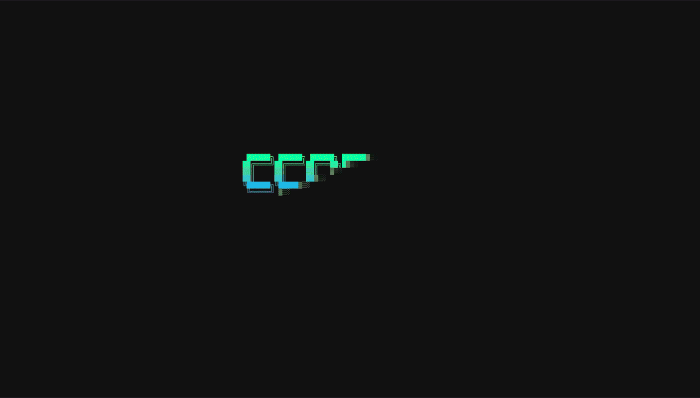

# ccorbit

[](https://github.com/lemassykoi/ccorbit/actions/workflows/ci.yml)
[](#license)

**This is a local fork:** the live source is [opencode](https://opencode.ai), and the sessions
shown are the ones talking to the LLM lanes served on this machine. It shows
sessions, subagents, skills and MCP servers, token flow, cost and context, as a wall of cards, a
live tree per session, a 3D hologram you can turn with the mouse, and a city of the files being
worked on. An optional read-only [engine pulse](#the-engine-pulse) sits in the footer, and
[remote hosts](#remote-hosts) let one **central** ccorbit watch the sessions on your other machines
(each publishing in **server mode** with `--export`).

**Compatibility:** this fork's live source is tested against **opencode 1.19** only. opencode's
storage schema is undocumented and moves; other versions may misread or show nothing (never
worse: the database is opened read-only, and a failed query reopens on the next poll). See
[docs/OPENCODE_FORMAT.md](docs/OPENCODE_FORMAT.md) for exactly what is read.

It is a single Rust binary of about 3.3 MB (SQLite rides along). It only reads the files opencode
already writes — its storage database, opened read-only: it never writes, never runs a command and
opens no network connection, except the opt-in [engine pulse](#the-engine-pulse) and — when you list
them — the body-free [remote hosts](#remote-hosts) exchange. It sits under
1% CPU at rest and about 3 MB of memory (measured on its daily machine); the 3D hologram costs a
few percent while it animates.



<sub>Recorded with `ccorbit --demo`: made-up sessions, nothing real.</sub>

## Install

Prebuilt binaries for Linux, macOS and Windows (x86_64 and Apple silicon), from this fork's
releases:

```sh
curl --proto '=https' --tlsv1.2 -LsSf https://github.com/lemassykoi/ccorbit/releases/latest/download/ccorbit-installer.sh | sh
```

Or build from this repository — Rust 1.85 or newer:

```sh
git clone https://github.com/lemassykoi/ccorbit.git && cd ccorbit
cargo install --path .
```

It is not on crates.io: that name is the upstream original this forked from.

Then run it:

```sh
ccorbit              # the wall of sessions
ccorbit --hud        # start on the 3D hologram
ccorbit --director   # the hologram with the camera running itself, for a second screen
ccorbit --demo       # made-up sessions: try it without opencode running
```

It runs wherever opencode runs. Where this fork is used daily: Linux on aarch64 (NVIDIA GB10).
Gradients and fog look best with 24-bit color (Ghostty, iTerm2, WezTerm, kitty, Warp and Windows
Terminal all have it); other terminals get the nearest 256-color shades.

### From source

```sh
git clone https://github.com/lemassykoi/ccorbit.git
cd ccorbit
cargo build --release
cp target/release/ccorbit ~/.local/bin/
```

### If the build fails on macOS

`tapi error: malformed file ... unknown architecture arm64e.x1-macos` means the Command Line Tools
linker is older than the default macOS SDK. Build against an SDK it can read:

```sh
ls /Library/Developer/CommandLineTools/SDKs/
SDKROOT=/Library/Developer/CommandLineTools/SDKs/MacOSX26.sdk cargo build --release
```

## Screens

Every session keeps one color everywhere: on its card, its tower, its feed lines, its planet in
the hologram and its district in the city. Two sessions in the same folder get a suffix
(`webapp·63`); a session from a remote host carries a host chip (`webapp · spark`).

### Wall (the start screen)

One card per running session, whatever its project:

- **Status:** BUSY, IDLE, ENDED, or a blinking NEEDS YOU when a question or a plan waits for your
  answer.
- **Current step:** it shimmers while it runs. "model · thinking or writing the next step" means
  the session is generating with no tool running.
- **Chips:** collisions (`✖`), warnings (`⚠`), the workflow race (`△`), agents, background tasks,
  skills and MCP servers.
- **Token flow** over the last minute, and the context gauge against the compaction ceiling.
- **Brainwave**, cache reactor, estimated price and model (see Readings).
- **Last prompt.**

Below the cards:

- **Skyline:** one isometric tower per session, its height following tokens per minute.
- **Signal feed:** the latest events of all sessions.

### Session (Enter on a card)

- **Vitals:**
  - three brainwave traces (thinking, writing, tools) over the last five minutes;
  - tokens sent and generated;
  - the prompt cache with its hit ratio and the estimated price;
  - the context against the compaction ceiling, with how many calls are left at the current pace.
- **Tree:** prompts and steps, subagents under the call that started them, and workflows with
  their phases. The agents of a running workflow appear live, each with its own steps. Slow or
  looping calls are marked `⚠`.
- **Detail** of the selected row. A workflow shows its race against an earlier run: two lanes on
  one time scale, ahead or behind, and the estimated time left.
- **Connections:** MCP servers and skills.

### HUD (`g`): the hologram

- **Layout:** the core sits in the middle. Sessions orbit it as planets on a tilted floor, and
  their agents and workflows circle them as moons. The MCP servers and skills they share hang on a
  crown around the edge.
- **Depth:** far things fade and shrink.
- **Packets** run along the links as work happens:
  - prompts come in from the core;
  - calls go out to agents, workflows and servers;
  - results come back, green when they succeed and red when they fail;
  - token traffic streams between each session and the core.
- **Events:** new nodes fly out from their parent, a rebuilt prompt cache flares, and two sessions
  changing the same file are joined by a flashing red link.
- **Mouse:**
  - drag to turn the view (across to spin, up and down to tilt);
  - wheel to zoom around the pointer;
  - click to lock a target, which dims what it is not linked to and opens a panel with its details;
  - double-click to open a session, or to fly to any other node.
- **Frame rate:** 30 frames per second, sharp at any size, for about 3% CPU; `--fps 60` for
  smoother still.
- **`v`** folds the view flat (seen from above) and back.
- **`d`** starts the director: the camera runs itself like a live broadcast.
  - It flies to whatever just happened (a session waiting for you, a collision, a failure, a slow
    or looping call, an agent or a workflow finishing) and holds the shot under a caption.
  - Between events it slowly circles the graph while the caption tours the sessions, and an inset
    follows the busiest session.
  - It also starts by itself after two minutes without input. Any key or click hands the camera
    back.

### Code city (`c`)

- **Districts and buildings:** every file the sessions read or changed is a building, grouped by
  project. A building's height follows the number of lines changed, and its color is the session
  that touched it last.
- **Signals:** fresh edits glow, windows light up while a file is being read, and a file two
  sessions change at once flashes red.
- **Side panel:** the selected file (who, when, lines added and removed) and the files that
  changed most.
- **Keys:** `[` and `]` change the time window (hour, 6 hours, 24 hours, everything loaded), and
  Enter opens the session that touched the selected file last.

### The engine pulse

With `--engines <FILE>` ccorbit reads, every two seconds, a small read-only status from the local
LLM engines you list — the share of prompts served from the KV/prefix cache, how full the pool is,
how many requests run, the decode rate and time-to-first-token — and shows one short line per
engine in the footer. The file is a JSON array, for example:

```json
[
  { "name": "vllm", "url": "http://127.0.0.1:30000/metrics", "kind": "vllm", "key_file": "~/.config/qwen38/api-key" },
  { "name": "strata", "url": "http://10.0.0.51:8013/status", "kind": "strata", "key_file": "~/.config/strata/api-key" }
]
```

`kind` is `vllm` (a Prometheus `/metrics`) or `strata` (a llama.cpp-style `/status`); it is
inferred from the url when left out. Only `http://` is read, replies are capped, and the addresses
are exactly those you wrote — the engine pulse and the two remote-host surfaces below are the only
network ccorbit ever uses, all through `src/net.rs`, and all off unless their flag is passed.

### Remote hosts

You run opencode on more than one machine and want one ccorbit to watch them all. It splits into
two roles, both opt-in: a **server** (`--export`) on each box publishes **body-free summaries**, and
a **central** (`--hosts`) polls them into one wall; a host that is down degrades on its own (its
cards dim, then leave) and never blocks the others.

**Server mode** — on every host (including, if you like, the central one), publish its summaries.
Two binaries do the identical job: **`ccorbit-export`** — the light wall-free exporter — or
`ccorbit --export` from the full binary, on a box that also shows a wall. Both come from the one
[Install](#install); there is no separate package. To try it in the foreground:

```sh
mkdir -p ~/.config/ccorbit
head -c 32 /dev/urandom | base64 > ~/.config/ccorbit/host-key   # one shared LAN key
chmod 600 ~/.config/ccorbit/host-key
ccorbit-export 0.0.0.0:30002                                      # or: ccorbit --export 0.0.0.0:30002
```

It reads only this box's `opencode.db` (read-only), and answers `GET /export` — with the
`~/.config/ccorbit/host-key` token presented — by shipping the same one-line summaries ccorbit keeps
in memory: never message bodies, reasoning text, edited text or file contents.

To keep the server up across reboots, drop in a systemd user unit on that box
(`~/.config/systemd/user/ccorbit-export.service`) and enable it:

```ini
[Unit]
Description=ccorbit exporter (publish this box's opencode summaries to a central ccorbit)
After=network-online.target

[Service]
ExecStart=%h/.local/bin/ccorbit-export 0.0.0.0:30002
Restart=on-failure
RestartSec=3

[Install]
WantedBy=default.target
```

```sh
systemctl --user daemon-reload && systemctl --user enable --now ccorbit-export
```

**Central mode** — on the box you watch from, list the peers in a JSON file and point `--hosts` at it:

```json
[
  { "name": "spark",  "url": "http://10.0.0.126:30002", "token_file": "~/.config/ccorbit/host-key" },
  { "name": "build",  "url": "http://10.0.0.134:30002", "token_file": "~/.config/ccorbit/host-key" }
]
```

```sh
ccorbit --hosts ~/.config/ccorbit/hosts.json
```

Remote sessions get a host chip on their card, in the header, the skyline and the code city; the
city keeps each machine's files in its own district, so two boxes editing `/home/you/app.ts` are not
mistaken for one file or a collision. Polling is `http://` only, one short connection per host per
second (backing off on failure), to the exact addresses you listed. This assumes a trusted LAN, like
`--engines`; it is not a tunnel and not encryption — do not export to an untrusted network. The
exporter refuses to serve without a key, and a host that disagrees on the wire or opencode version is
shown as an error rather than misread. See [docs/DECISIONS.md](docs/DECISIONS.md), "Remote opencode
hosts", for why this is an exporter and not `opencode serve`.

## Keys

| Where | Keys |
|---|---|
| Everywhere | `?` help · `g` HUD · `c` code city · `t` theme · `x` effects on or off · `m` mouse capture off (to select text) · `q` quit |
| Wall | arrows or `hjkl` select · Enter open · mouse: click selects, click again opens, wheel moves |
| Session | arrows or `jk` move · Enter fold · `e` expand all · `f` follow the newest step · `Tab` next session · `Esc` back |
| HUD | `Tab` or arrows cycle targets · Enter open · `f` fly to the target · `+` `-` zoom · `0` reset the view · `v` flat or 3D · `d` director · space ping · `Esc` drop the target, then back |
| Code city | arrows move · Enter open the session · `[` `]` time window · `Esc` back |
| Replay | `p` pause · `<` `>` speed |

## Options

| Option | Effect |
|---|---|
| `--hud` | Start on the hologram |
| `--director` | Start on the hologram with the director at the camera |
| `--fps <N>` | Frames per second of the hologram, default 30 (60 costs about 5% CPU) |
| `--demo` | Show made-up sessions instead of yours: to try it, or to record it without showing your work |
| `--replay <FILE>` | Play back a recorded transcript in the transcript format (`.jsonl`), at speed |
| `--speed <N>` | Replay speed, default 20 (idle stretches are skipped) |
| `--theme <NAME>` | `phosphor` (default), `amber` or `neon` |
| `--opencode-db <PATH>` | opencode storage database, default `$XDG_DATA_HOME/opencode/opencode.db` |
| `--engines <FILE>` | JSON file listing the local LLM engines to show a read-only pulse of (see [The engine pulse](#the-engine-pulse)) |
| `--hosts <FILE>` | JSON file listing remote ccorbit exporters to fold into the wall (see [Remote hosts](#remote-hosts)) |
| `--export <ADDR>` | Publish this machine's summaries to other ccorbits, at `host:port` (see [Remote hosts](#remote-hosts)) |
| `--no-boot` | Skip the boot animation |
| `--dump` | Print every session and its readings as plain text, then exit |
| `--help`, `--version` | Print the options, or the version, then exit |

## What it reads

Only the files opencode already writes, opened read-only. No hook, no settings change, no command;
the network is touched only by `--engines` and, when you opt in, the body-free `--hosts`/`--export`
exchange (see above) — all of it through `src/net.rs`.

| Path | Used for |
|---|---|
| `session` (table) | Which sessions ran recently: id, parent, directory, title, model, times |
| `message` (table) | Prompts and answers: role, model, when the turn completed |
| `part` (table) | Steps and their states, reasoning and text timings, token usage per step, compactions, subagent launches, file edits |
| `permission` (table) | Not read yet: a question waiting shows as its unanswered `question` tool call |
| `~/.config/opencode/opencode.json` | The `mcp` server names, so a tool called `server_tool` is recognized as MCP |

Rows hold your work. ccorbit keeps one-line summaries, counts and times in memory: never message
bodies, reasoning text, edited text or file contents. It never writes anything anywhere; the
database is opened `READ_ONLY` and WAL readers never block the writer.

## Limits

- The storage schema is not a documented interface. This was built against opencode 1.19 and may
  need changes when it moves; a query failure reopens the database on the next tick.
- Token rates are counted when each `step-finish` row settles, so a long reply shows as a burst.
- "Sent" counts every input token the model processes, cache reads included, which is why it is
  much larger than "generated".
- A local engine reports its cache hits only in aggregate: the per-session cache reactor reads
  zero while the footer's engine pulse carries the true share (from the engine's counters).
- A session quiet for twenty minutes drops off the wall (a closing a chat leaves no trace in the
  database): its card returns the moment anything is written to it again. Archiving or deleting a
  session in opencode removes its card at once.
- Nothing in the database says "this opencode process died": a turn left open with no row moving
  for ten minutes is treated as crashed, and its open calls close as lost. A legitimate tool that
  runs silent past ten minutes shows idle meanwhile and heals itself on the next row. A question
  waiting for an answer is never closed this way: it keeps its NEEDS YOU.

## Development

The repository is set up so that a coding agent (or a person) can change it safely:
[AGENTS.md](AGENTS.md) is the map, `docs/` holds the architecture, the promises and the checks that
enforce them, the format of the rows read and the decisions, and one command checks everything:

```sh
scripts/verify.sh              # formatting, lints, tests, golden screens, rules, budgets (CI runs it too)
cargo test                     # while working
UPDATE_GOLDEN=1 cargo test     # accept an intended screen change, then read git diff tests/golden
cargo run --release -- --dump  # check the readings against your own sessions
```

| File | Role |
|---|---|
| `src/main.rs` | Options and startup |
| `src/source.rs` | The three sources — live opencode, replay, demo — and the `World` clock |
| `src/opencode.rs` | The live source: reads opencode's storage database, translates rows into transcript records |
| `src/engines.rs` | The read-only engine pulse: vLLM Prometheus and llama.cpp-style status over one short HTTP GET each |
| `src/hosts.rs` | The `--hosts` poller: folds remote ccorbit exporters' summaries into the wall (host-qualified ids, per-host staleness and backoff) |
| `src/net.rs` | The only socket code: the shared `http_get` client (behind `--engines` and `--hosts`) and the `--export` `TcpListener` |
| `src/bin/ccorbit-export.rs` | The light standalone exporter (server mode): the same reader compiled without the terminal, so boxes you only publish from carry none of the wall |
| `src/model.rs` | Session state built from transcript lines: steps, agents, tokens, phases, files, compactions |
| `src/insight.rs` | Readings across sessions: slow and looping calls, collisions, workflow races, compaction ceilings |
| `src/price.rs` | API list prices |
| `src/parse.rs` | Tolerant readers for the pieces of records shown on screen |
| `src/ui.rs` | Boot screen, wall, skyline, session view, keys and mouse, plain-text dump |
| `src/ui/vitals.rs` | Brainwave, cache reactor, context gauge, race lanes |
| `src/ui/city.rs` | The code city |
| `src/hud.rs` | The hologram: layout, camera, animation, packets, hit tests, target panel |
| `src/hud/director.rs` | The director |
| `src/demo.rs` | The made-up sessions of `--demo`, written as transcript records |
| `src/theme.rs` | Palettes, gradients, fog and the 256-color fallback |
| `src/time.rs` | Timestamps, durations and compact numbers |

`docs/demo.tape` records `docs/demo.gif` with [vhs](https://github.com/charmbracelet/vhs).

Hidden options for checking things without a terminal:

- `--snapshot WxH` prints one frame of each view as text.
- `--snapshot-html WxH DIR` writes colored HTML frames you can open in a browser.
- `--bench-hud WxH` draws 300 frames of the hologram and reports the time each took.

### Releasing

Releases are built by [dist](https://axodotdev.github.io/cargo-dist/) from a version tag:

1. Set the version in `Cargo.toml`, move the changes in `CHANGELOG.md` under it, commit to `main`.
2. Tag and push: `git tag -a v0.4.0 -m "ccorbit 0.4.0" && git push origin v0.4.0`. The release
   workflow builds the archives and the installer and publishes them as a GitHub release on this
   repository.
3. The fork does not publish to crates.io (the name is upstream's) and does not feed the upstream
   Homebrew tap. Most days the install is simply `cargo install --path .`.

## License

Copyright (c) 2026 Pierre CANGEMI. Licensed under either of [Apache License, Version 2.0](LICENSE-APACHE) or [MIT license](LICENSE-MIT),
at your option.

Unless you explicitly state otherwise, any contribution intentionally submitted for inclusion in
ccorbit by you, as defined in the Apache-2.0 license, shall be dual licensed as above, without any
additional terms or conditions.
